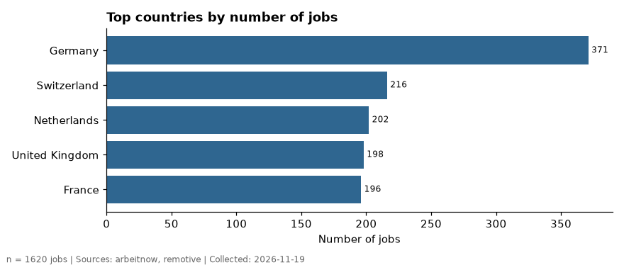
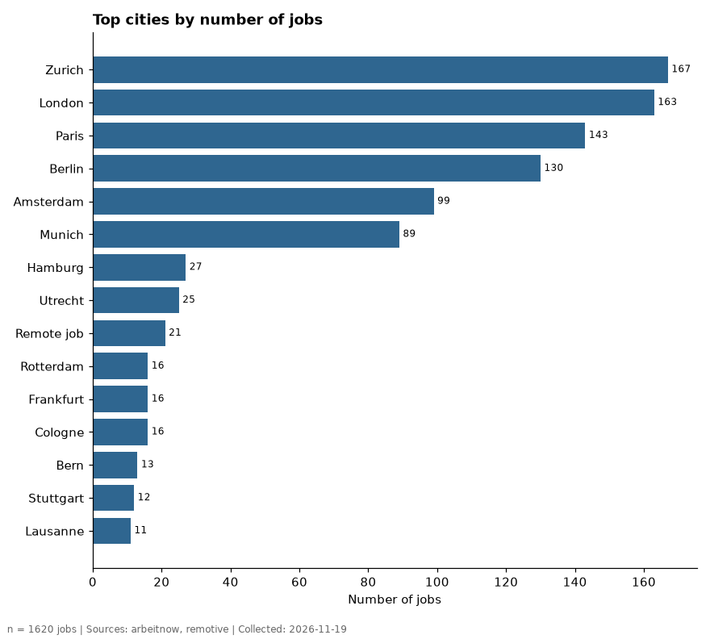
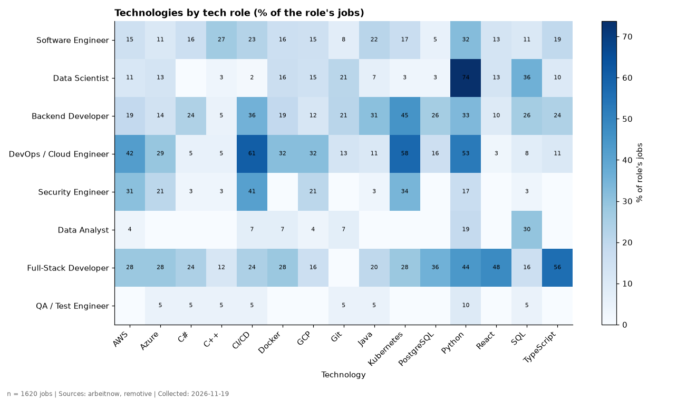
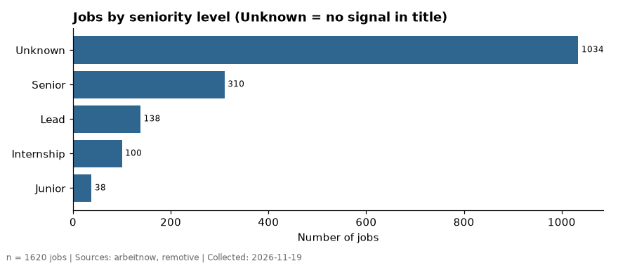
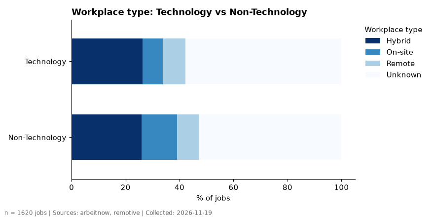
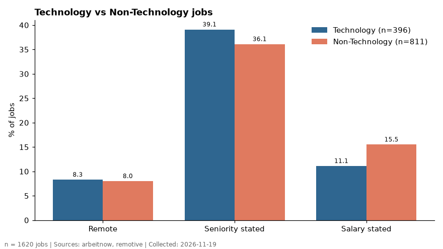
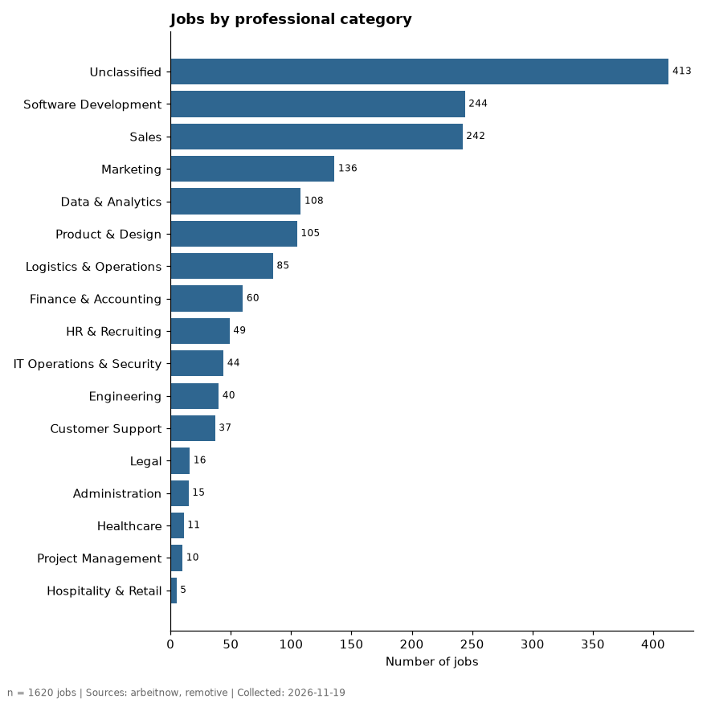
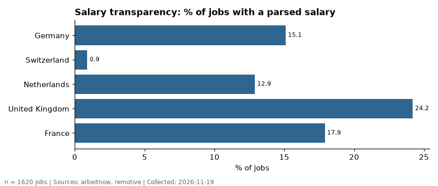
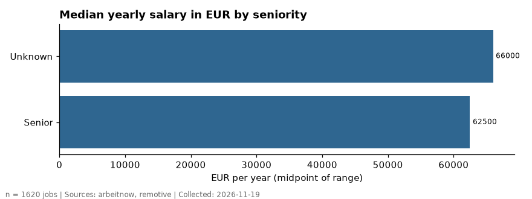

# Job Market Intelligence

**European job market and technology demand analysis.** A small, reproducible Python project that collects job postings from public APIs, cleans and normalizes them, stores them in SQLite and analyzes them with SQL and pandas, with a focus on the **technology sector compared with the rest of the job market**.

The README has two parts:

- **[Part 1: Analysis](#part-1-analysis)** - questions, findings, charts, data and limitations.
- **[Part 2: Technical Documentation](#part-2-technical-documentation)** - stack, architecture, database, installation and usage.

> **Status:** the code and tests are complete. Findings and chart interpretations are filled in from real data after the first run. Nothing in this report is written before the data exists.

---

# Part 1: Analysis

## 1. Project Overview

**Goal:** describe what job postings in Europe look like in the collected sample, with a focus on Tech vs Non-Tech.

**Research questions**
1. **Geography:** Which countries and cities have the most postings?
2. **Technologies:** Which technologies are requested most often, and for which tech roles?
3. **Seniority:** How are postings split between Internship, Junior, Mid, Senior and Lead?
4. **Workplace:** What share of postings is Remote, Hybrid or On-site?
5. **Salary:** How often are salaries disclosed, and what do disclosed salaries look like?
6. **Tech vs Non-Tech:** How does the technology sector differ from other jobs?

---

## 2. Key Findings

_To be completed after the first run. The pipeline writes a factual summary to `reports/summary.md` (sample size, data quality, top countries, top technologies, Tech vs Non-Tech table, salary medians). Copy the most important numbers here and always state the sample size and collection date._

- Sample: `<n>` jobs from `<sources>`, collected on `<date>`
- Geography: `<finding>`
- Technologies: `<finding>`
- Seniority and workplace: `<finding>`
- Salary: `<finding, with n>`
- Tech vs Non-Tech: `<finding>`

---

## 3. Results & Visualizations

All charts are created by the pipeline in `reports/figures/`. Each chart shows the sample size and collection date in its footer. Groups with fewer than 10 jobs are not shown.

### Geography


> **Question:** Which countries have the most postings in the sample?  
> **Interpretation:** _add after reading the chart and `reports/summary.md`._


> **Question:** Which cities are the biggest hiring centers?  
> **Interpretation:** _add after reading the chart and `reports/summary.md`._

---

### Technology demand


> **Question:** Which technologies are requested most often?  
> **Interpretation:** _add after reading the chart and `reports/summary.md`._


> **Question:** Which technologies go with which tech role?  
> **Interpretation:** _add after reading the chart and `reports/summary.md`._

---

### Seniority and workplace


> **Question:** How are postings distributed by seniority? `Unknown` means the title has no seniority signal.  
> **Interpretation:** _add after reading the chart and `reports/summary.md`._


> **Question:** What share of jobs is Remote, Hybrid or On-site?  
> **Interpretation:** _add after reading the chart and `reports/summary.md`._

---

### Tech vs Non-Tech


> **Question:** How do Tech and Non-Tech jobs differ on remote share, stated seniority and stated salary?  
> **Interpretation:** _add after reading the chart and `reports/summary.md`._


> **Question:** Which professional categories are most common?  
> **Interpretation:** _add after reading the chart and `reports/summary.md`._

---

### Salary


> **Question:** In which countries do employers state a salary more often?  
> **Interpretation:** _add after reading the chart and `reports/summary.md`._


> **Question:** How do disclosed yearly EUR salaries differ by seniority? Created only if there are enough salary records, otherwise the file does not exist.  
> **Interpretation:** _add after reading the chart and `reports/summary.md`._

---

## 4. Data & Methodology

### Data sources

| Source | Access | Coverage | Notes |
|---|---|---|---|
| [Arbeitnow](https://www.arbeitnow.com/api/job-board-api) | Free public JSON API, no key, paginated | Mostly Germany and neighbouring countries | Title, company, HTML description, location, tags, job types, remote flag. No salary field. |
| [Remotive](https://remotive.com/api/remote-jobs) | Free public JSON API, no key | Remote jobs worldwide; only those mentioning Europe, EMEA, EU or a European country are kept | Free-text salary field. Its documentation asks users to limit requests, credit Remotive and link back to the job page. |

Please check each provider's current terms before publishing results. The collection date is part of every raw file name (`data/raw/<source>_<timestamp>.json`) and of the `collected_at` column. Adzuna was considered and excluded because of its access conditions.

### How the data was processed

1. **Cleaning:** duplicates by slug and records without slug, title, company or location are removed; HTML and HTML entities (including double-escaped HTML) are converted to plain text.
2. **Location:** city, country and ISO code from a built-in dictionary of European countries and common cities. If the country cannot be identified, it stays empty.
3. **Dates and employment type:** dates are converted to `YYYY-MM-DD`; employment type is Full-time, Part-time, Contract, Internship or Unknown.
4. **Workplace type:** Remote, Hybrid or On-site only when there is an explicit signal, otherwise Unknown.
5. **Salary:** min, max, currency and period are extracted when a currency is present. The period is `explicit` (e.g. "per year") or `inferred` (values of 10,000 or more are treated as yearly). Numbers without a clear period are not stored as numeric salaries; the original text stays in `salary_raw`.
6. **Seniority:** detected from the job title only.
7. **Job category and role:** rule-based, from title keywords, then from source tags. `classification_method` records which one matched.
8. **Industry:** *Technology* for Data & Analytics, Software Development and IT Operations & Security roles; *Non-Technology* for other classified roles; *Unknown* otherwise. The sources do not provide the employer's industry, so this is a role-based approximation.
9. **Technologies:** about 50 technologies found by whole-word matching in title, tags and description.
10. **Deduplication:** within a source by slug, across sources by a key of normalized title, company and city.
11. **Analysis:** SQL queries plus pandas. Medians are shown only for groups with at least 10 jobs, and salary comparison uses yearly EUR salaries only.

---

## 5. Limitations

- The data covers the selected sources only, not all jobs in Europe. Counts are **not** the total number of vacancies in a country.
- One collection is a snapshot, not a historical trend.
- Arbeitnow is mostly German-speaking markets, so country comparisons are biased toward them. Remotive contains only remote jobs.
- Salaries are rare. Only salaries with a currency and a clear period are parsed, and currencies are not converted.
- Seniority is detected from titles only; many titles have no signal and stay `Unknown`.
- Workplace type is mostly `Unknown` unless a posting states it explicitly.
- Industry is derived from the job role, not from the employer's sector.
- Rule-based classification and skill matching can be wrong or incomplete.
- Cross-source deduplication can miss or wrongly merge some postings.

---

# Part 2: Technical Documentation

## 6. Technology Stack

Python, requests, pandas, NumPy, BeautifulSoup4, SQLite / SQL, matplotlib, pytest, python-dotenv.

---

## 7. Project Architecture

```
job-market-intelligence/
├── data/
│   ├── raw/                 # raw API responses (not tracked by git)
│   └── database/            # SQLite database (not tracked by git)
├── reports/
│   ├── figures/             # generated charts
│   └── summary.md           # generated factual summary
├── src/
│   ├── collectors/          # API clients, raw file storage
│   ├── processing/          # standardize, clean, normalize, classify, salary
│   ├── database/            # SQLite schema and loading
│   ├── analysis/            # SQL queries and summary report
│   └── visualization/       # matplotlib charts
├── tests/                   # pytest tests with mock API data
├── config.py                # paths and settings
├── run_pipeline.py          # runs the whole pipeline
├── requirements.txt
├── .env.example
└── README.md
```

---

## 8. Pipeline

`run_pipeline.py` runs these steps in order:

1. **Collect** data from each source (retries, delay between requests, pagination).
2. **Save raw** responses unchanged to `data/raw/`.
3. **Standardize** every source into one common job structure.
4. **Clean** (duplicates, empty records, HTML).
5. **Normalize and classify** (location, dates, workplace, salary, seniority, role, technologies).
6. **Deduplicate** across sources.
7. **Load** into SQLite (upsert, so re-runs do not create duplicates).
8. **Analyze** with SQL queries and pandas.
9. **Visualize** and save charts to `reports/figures/`.
10. **Summarize** into `reports/summary.md`.

If one source fails, it is skipped and the others continue.

---

## 9. Database

SQLite file: `data/database/jobs.db` (created on the first run).

| Table | Purpose |
|---|---|
| `jobs` | One row per job: source, title, company, location, classification, workplace, salary, dates. `UNIQUE(source, source_job_id)` prevents duplicates. |
| `skills` | Dictionary of technologies with their category. |
| `job_skills` | Links jobs to skills (`job_id`, `skill_id`). |

Indexes exist on country, job category, industry, seniority and the deduplication key. To browse the file in VS Code, install the **SQLite Viewer** extension; alternatively use DB Browser for SQLite.

---

## 10. Installation & Usage

```bash
# 1. Create and activate a virtual environment
python -m venv .venv
source .venv/bin/activate        # Windows: .venv\Scripts\activate

# 2. Install dependencies
pip install -r requirements.txt

# 3. (Optional) configure settings
cp .env.example .env

# 4. Run the full pipeline
python run_pipeline.py
```

Options:

```bash
python run_pipeline.py --sources arbeitnow        # only one source
python run_pipeline.py --skip-collect             # reuse the latest raw files, no API calls
python run_pipeline.py --skip-analysis            # only collect, process and store
```

Running the pipeline again updates existing jobs and adds new ones without duplicates.

---

## 11. Testing

```bash
pytest
```

Tests use mock API responses, so no internet is needed. They cover data collection, HTML cleaning, duplicates, empty values, dates and locations, salary extraction, skill extraction, classification, and reading and writing SQLite.

---

## 12. Future Improvements

- Add more sources (checked for terms, quality and coverage first).
- Improve classification, for example with the ESCO taxonomy.
- Extend the city and country dictionaries.
- Collect on a schedule to build a time series and analyze trends.
- Convert currencies and compare salaries with cost of living.
- Add statistical tests for Tech vs Non-Tech differences.

---

_Principle: collect real data, check its quality, state the limits, and only then draw conclusions._
