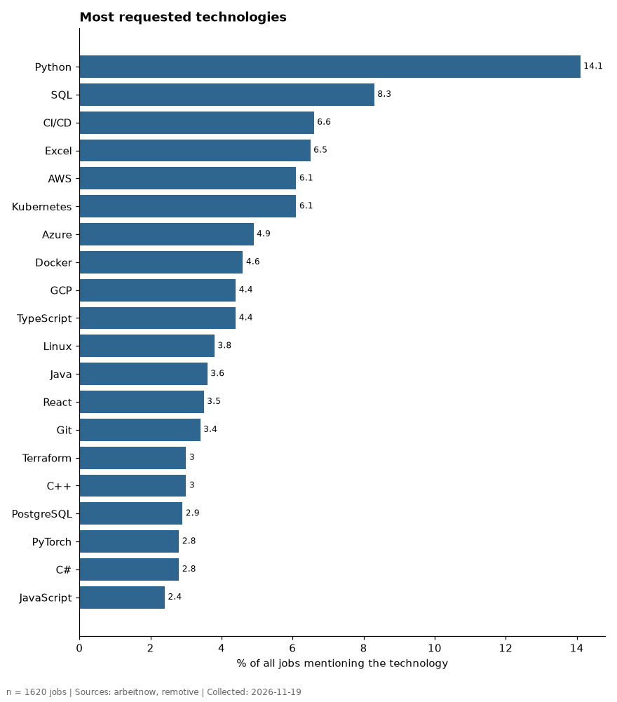

# Job Market Intelligence

**European job market and technology demand analysis** — a small, reproducible Python pipeline that collects job postings from public APIs, cleans and normalizes them, stores them in SQLite, and analyzes them with SQL and pandas. The main focus is the **technology sector compared with the rest of the job market**.

> **Status:** the code and tests are complete. The *Key Findings* and *Results* sections below are filled in from real data after the first run (see [Installation & Usage](#8-installation--usage)). Nothing in this report is written before the data exists.

---

## 1. Project Overview

### Goal
Build a complete data analytics workflow — API → cleaning → normalization → SQLite → SQL/pandas analysis → charts → written conclusions — and use it to describe what job postings in Europe look like, with a focus on Tech vs Non-Tech.

### Research questions
1. **Geography:** Which countries and cities have the most postings in the sample?
2. **Technologies:** Which technologies are requested most often, and for which tech roles?
3. **Seniority:** How are postings split between Internship, Junior, Mid, Senior and Lead?
4. **Workplace:** What share of postings is Remote, Hybrid or On-site?
5. **Salary:** How often are salaries disclosed, and what do disclosed salaries look like?
6. **Tech vs Non-Tech:** How does the technology sector differ from other jobs (remote share, salary transparency, seniority information, location)?

---

## 2. Key Findings

_To be completed after the first run. The pipeline writes a factual, auto-generated summary to `reports/summary.md` (sample size, data quality, top countries, top technologies, Tech vs Non-Tech table, salary medians). Copy the most important numbers here and always state the sample size and collection date._

- Sample: `<n>` jobs from `<sources>`, collected on `<date>`
- Geography: `<finding>`
- Technologies: `<finding>`
- Seniority / Workplace: `<finding>`
- Salary: `<finding, with n>`
- Tech vs Non-Tech: `<finding>`

---

## 3. Project Results & Visualizations

Figures are created in `reports/figures/` by the pipeline. After the first run, commit them and add a short interpretation under each one.

| # | Figure | Question it answers |
|---|---|---|
| 1 | `01_jobs_by_country.png` | Which countries have the most postings? |
| 2 | `02_jobs_by_city.png` | Which cities are the biggest hiring centers? |
| 3 | `03_top_technologies.png` | Which technologies are requested most? |
| 4 | `04_skills_by_role_heatmap.png` | Which technologies go with which tech role? |
| 5 | `05_seniority.png` | How are postings distributed by seniority? |
| 6 | `06_workplace_by_industry.png` | Remote / Hybrid / On-site: Tech vs Non-Tech |
| 7 | `07_tech_vs_nontech.png` | How do Tech and Non-Tech differ on key shares? |
| 8 | `08_job_categories.png` | Which professional categories are most common? |
| 9 | `09_salary_transparency.png` | In which countries are salaries stated more often? |
| 10 | `10_salary_by_seniority.png` | Median yearly EUR salary by seniority (only if enough data) |

Example (after the first run):

```markdown

**Interpretation:** ... (what the chart shows, why it matters, what limits it)
```

Charts for groups with fewer than `MIN_GROUP_SIZE` (10) jobs are not drawn, to avoid conclusions from tiny samples.

---

## 4. Data Sources

| Source | Access | Coverage | Notes |
|---|---|---|---|
| [Arbeitnow](https://www.arbeitnow.com/api/job-board-api) | Free public JSON API, no key, paginated | Mostly Germany and neighbouring countries | Provides title, company, HTML description, location, tags, job types, remote flag. No salary field. |
| [Remotive](https://remotive.com/api/remote-jobs) | Free public JSON API, no key | Remote jobs worldwide; only those mentioning Europe, EMEA, EU or a European country are kept | Has a free-text salary field. Its API documentation asks users to limit requests (a few per day), credit Remotive as the source and link back to the job page. |

**Please check each provider's current terms before publishing results.** Dates of collection are recorded in every raw file name (`data/raw/<source>_<timestamp>.json`) and in the `collected_at` column.

Adzuna was considered and excluded because of its access conditions.

---

## 5. Methodology

1. **Collection** — one collector per source, with retries, a delay between requests and pagination. If a later page fails, earlier pages are kept. Raw responses are saved unchanged to `data/raw/` and never overwritten.
2. **Standardization** — every source is mapped to one common job structure.
3. **Cleaning** — duplicates by slug, records without slug/title/company/location removed, HTML and HTML entities (including double-escaped HTML) converted to plain text, whitespace normalized.
4. **Normalization**
   - Location → city, country, ISO code using a built-in dictionary of European countries and common cities. If the country cannot be identified, it stays `NULL`.
   - Dates → `YYYY-MM-DD`.
   - Employment type → Full-time, Part-time, Contract, Internship or Unknown.
   - Workplace type → Remote, Hybrid or On-site only when there is an explicit signal; otherwise Unknown.
   - Salary → min, max, currency and period are extracted when a currency is present. The period is either `explicit` (e.g. "per year") or `inferred` (values of 10,000 or more are treated as yearly). Numbers without a clear period are **not** stored as numeric salaries; the original text stays in `salary_raw`.
5. **Classification** — rule-based and transparent (see `src/processing/classification.py`):
   - *Seniority* from the job title only.
   - *Job category and role* from title keywords, then from source tags. `classification_method` records which one matched.
   - *Industry* is **Technology** for Data & Analytics, Software Development and IT Operations & Security roles, **Non-Technology** for all other classified roles, and **Unknown** otherwise. The sources do not provide the company's industry, so this is a role-based approximation.
6. **Skills** — about 50 technologies (languages, frameworks, databases, cloud/DevOps, data/ML, BI tools) are found by whole-word matching in title, tags and description.
7. **Deduplication** — within a source by slug; across sources by a key built from normalized title, company and city.
8. **Storage** — SQLite with `jobs`, `skills` and `job_skills`; `UNIQUE(source, source_job_id)` plus upsert makes re-runs safe.
9. **Analysis** — SQL queries in `src/analysis/queries.py`, aggregation in pandas, medians only for groups with at least 10 jobs, salary comparison limited to yearly EUR salaries.

---

## 6. Technology Stack

Python · requests · pandas · NumPy · BeautifulSoup4 · SQLite / SQL · matplotlib · pytest · python-dotenv

---

## 7. Project Architecture

```
job-market-intelligence/
├── data/
│   ├── raw/                 # raw API responses (not tracked by git)
│   └── database/            # SQLite database (not tracked by git)
├── reports/
│   ├── figures/             # generated charts
│   └── summary.md           # generated factual summary
├── src/
│   ├── collectors/          # API clients, raw file storage
│   ├── processing/          # standardize, clean, normalize, classify, salary
│   ├── database/            # SQLite schema and loading
│   ├── analysis/            # SQL queries and summary report
│   └── visualization/       # matplotlib charts
├── tests/                   # pytest tests with mock API data
├── config.py                # paths and settings
├── run_pipeline.py          # runs the whole pipeline
├── requirements.txt
├── .env.example
└── README.md
```

---

## 8. Installation & Usage

```bash
# 1. Create and activate a virtual environment
python -m venv .venv
source .venv/bin/activate        # Windows: .venv\Scripts\activate

# 2. Install dependencies
pip install -r requirements.txt

# 3. (Optional) configure settings
cp .env.example .env

# 4. Run the full pipeline
python run_pipeline.py
```

Useful options:

```bash
python run_pipeline.py --sources arbeitnow        # only one source
python run_pipeline.py --skip-collect             # reuse the latest raw files, no API calls
python run_pipeline.py --skip-analysis            # only collect, process and store
```

Running the pipeline again does not create duplicates: existing jobs are updated, new jobs are added. If one source fails, it is skipped and the others continue.

```bash
# Run tests (no internet needed, APIs are mocked)
pytest
```

---

## 9. Limitations

- The data covers the selected sources only, not all jobs in Europe. Counts are **not** the total number of vacancies in a country.
- One collection is a snapshot, not a historical trend.
- Arbeitnow is mostly German-speaking markets, so country comparisons are biased toward them. Remotive contains only remote jobs.
- Salaries are rare. Only salaries with a currency and a clear period are parsed, and only yearly EUR salaries are compared. Currencies are not converted.
- Seniority is detected from titles only; many titles have no signal and stay `Unknown`.
- Workplace type is mostly `Unknown` unless a posting states it explicitly.
- Industry is derived from the job role, not from the employer's sector.
- Rule-based classification and skill matching can be wrong or incomplete; short or unusual titles may stay unclassified.
- Cross-source deduplication is based on title, company and city and can miss or wrongly merge some postings.

---

## 10. Future Improvements

- Add more sources (checked for terms, quality and coverage first).
- Improve classification, for example with the ESCO taxonomy.
- Extend geography and city/country dictionaries.
- Collect on a schedule to build a time series and analyze trends.
- Convert currencies and compare salaries with cost of living.
- Add statistical tests for Tech vs Non-Tech differences.

---

_Principle: collect real data, check its quality, state the limits, and only then draw conclusions._
